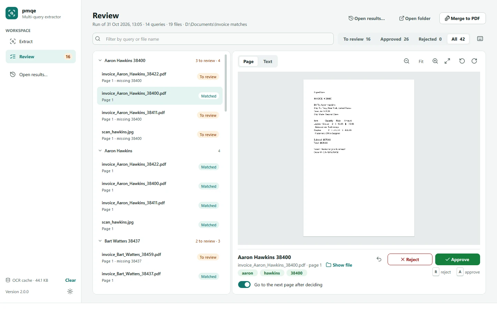
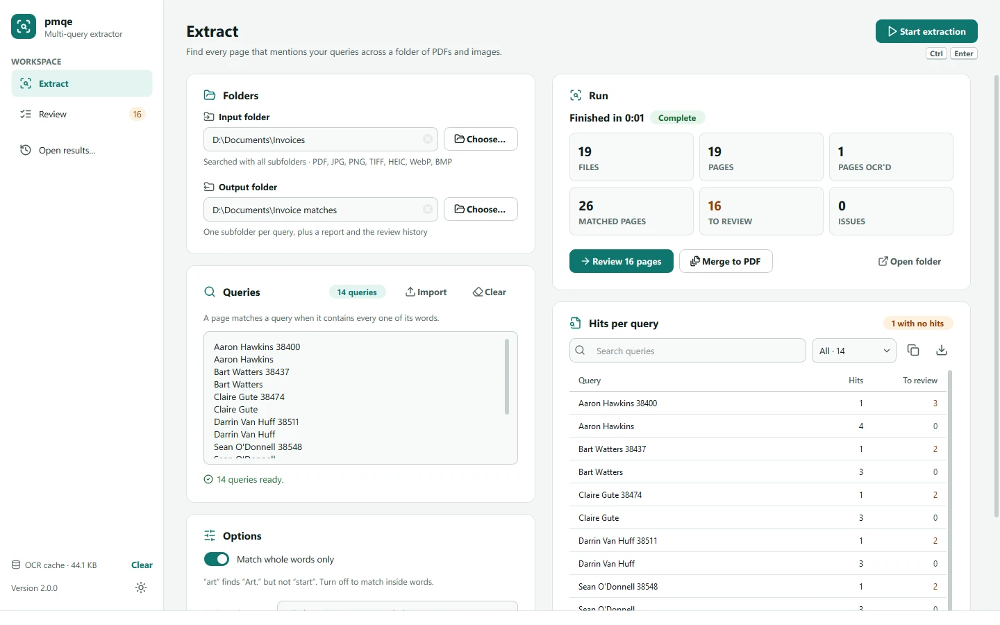
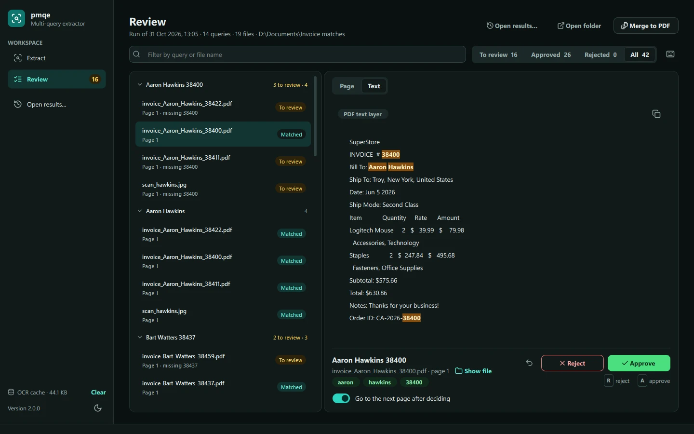

# pmqe — PDF & Image Multi-Query Extractor

[](https://github.com/fubaris42/pmqe/actions/workflows/ci.yml)

<picture>
  <source media="(prefers-color-scheme: dark)" srcset="screenshots/review-dark.webp">
  
</picture>

pmqe searches a whole folder of PDFs and images for a list of queries at
once, saves every matching page into a folder per query, and gives you a
fast, keyboard-driven panel to approve or reject the near misses. Scanned
pages are OCR'd automatically. When you're done, everything can be merged
into one PDF with a bookmark per query.

## Features

- **Many queries in one pass.** One query per line; a page matches when it
  contains every word of the query. Matching is case-insensitive and
  whole-word (`art` finds "Art." but not "start"), copes with PDF ligatures
  (fi, fl), full-width characters and words hyphenated across lines.
- **Near misses go to review, not the bin.** A page with some but not all
  words of a query becomes a candidate you can approve or reject.
- **Every common document format:** PDF, JPG, PNG, multi-page TIFF, HEIC
  (iPhone photos), WebP and BMP, in all subfolders.
- **OCR only where it's needed,** decided page by page, so a typed cover
  sheet followed by scans is handled correctly. Uses the platform's engine
  (Windows OCR, Apple Vision) with RapidOCR as a per-page fallback; results
  are cached, so re-running with new queries skips OCR.
- **Fast and sturdy.** Files are processed in parallel; a corrupt file is
  reported instead of stopping the run, a file that crashes a worker is
  isolated, cancelling stops within seconds, and outputs are written
  atomically.
- **Review that keeps up with you:** keyboard shortcuts, bulk decisions,
  undo, auto-advance, a page view and a text view with the matches
  highlighted. Decisions are saved as you go; reopen any earlier run later.
- **Light and dark themes** that follow your system, with WCAG AA contrast.

<table>
  <tr>
    <td></td>
    <td></td>
  </tr>
</table>

## Install and run

You need [uv](https://docs.astral.sh/uv/); it fetches a suitable Python
(3.10 or newer) by itself.

```console
uv run pmqe                 # run from a checkout
uv tool install .           # or install the `pmqe` command
```

From 2.0.0, each [GitHub release](https://github.com/fubaris42/pmqe/releases)
includes ready-made Windows and macOS (Apple Silicon) apps: unzip, then run
`pmqe\pmqe.exe` on Windows, or move `pmqe.app` to Applications on a Mac.

The apps aren't code-signed yet, so the first launch shows a warning:

- **Windows:** "Windows protected your PC" → **More info** → **Run anyway**.
- **macOS:** "Apple could not verify…" → open **System Settings → Privacy &
  Security** and click **Open Anyway**.

## Using it

1. **Extract** — choose an *input folder* (searched with all subfolders) and
   an *output folder*, then type or import your queries (a `.txt` file with
   one query per line; lines starting with `[` are ignored). Press
   **Start extraction** or <kbd>Ctrl</kbd>+<kbd>Enter</kbd>.
2. Watch progress with an estimate of the time left. Afterwards you'll see
   totals and a table of hits per query. Search it, show only queries with or
   without hits (or with pages to review), sort by any column, and copy
   cells straight into Excel or a document (<kbd>Ctrl</kbd>+<kbd>C</kbd>), or
   export it as CSV. Right-click → *Copy queries only* gives you the
   unmatched queries, ready to paste back in for another run.
3. **Review** — the queue opens on the pages that need a decision. Approve
   or reject with the keyboard; approving writes the page into the query's
   folder, rejecting removes it. Select several pages to decide in bulk.
4. **Merge to PDF** combines every approved page into
   `merged_all_queries.pdf`, bookmarked by query and page.

Use **Open results…** (<kbd>Ctrl</kbd>+<kbd>O</kbd>) to pick up the review of
an earlier run where you left off.

### Keyboard shortcuts

| Key | Action |
| --- | --- |
| <kbd>A</kbd> | Approve the selected pages |
| <kbd>R</kbd> or <kbd>Delete</kbd> | Reject the selected pages |
| <kbd>J</kbd> / <kbd>K</kbd>, <kbd>↓</kbd> / <kbd>↑</kbd> | Next / previous page |
| <kbd>Space</kbd> | Switch between the page and its text |
| <kbd>+</kbd> / <kbd>−</kbd> / <kbd>0</kbd> | Zoom in / out / fit (or <kbd>Ctrl</kbd>+wheel) |
| <kbd>[</kbd> / <kbd>]</kbd> | Rotate left / right |
| <kbd>Ctrl</kbd>+<kbd>Z</kbd> | Undo the last decision |
| <kbd>Ctrl</kbd>+<kbd>F</kbd> | Filter the review list (on Extract: search the hits table) |
| <kbd>Ctrl</kbd>+<kbd>C</kbd> | Copy the selected cells of the hits table |
| <kbd>Ctrl</kbd>+<kbd>1</kbd> / <kbd>Ctrl</kbd>+<kbd>2</kbd> | Extract / Review |
| <kbd>Ctrl</kbd>+<kbd>Enter</kbd> | Start extraction |

## What ends up in the output folder

```text
Output/
├── Aaron Hawkins 38461/             one folder per query
│   ├── invoice_p1_<hash>.pdf        one PDF per matching page
│   └── scan_hawkins_<hash>.jpg      single images are copied as they are
├── report.csv                       approved pages and pages awaiting review, per query
├── issues.csv                       files that could not be (fully) read, if any
├── extraction_history.db            the run: settings, queries, every match and decision
├── extractor.log                    this run's log
└── merged_all_queries.pdf           after "Merge to PDF"
```

Starting a new run into a folder that already holds results asks first and
then replaces them. Only files pmqe created are touched.

`extraction_history.db` keeps the `summary_metrics` and `candidates_log`
tables of earlier versions (with `pre_approved` holding the current
decision), so existing tooling keeps working.

## Where pmqe keeps its own files

| | Windows | macOS | Linux |
| --- | --- | --- | --- |
| OCR cache | `%LOCALAPPDATA%\pmqe\Cache` | `~/Library/Caches/pmqe` | `~/.cache/pmqe` |
| App log | `%LOCALAPPDATA%\pmqe\Logs` | `~/Library/Logs/pmqe` | `~/.local/state/pmqe` |

The cache is keyed by file content, so it is shared between folders and
survives moving files around. Its size is shown at the bottom of the sidebar,
with a button to clear it. `PMQE_CACHE_DIR`, `PMQE_LOG_DIR` and
`PMQE_LOG_LEVEL=DEBUG` override these.

## Performance

`bench/benchmark.py` builds a synthetic corpus with known answers — 213
files, 1,553 pages: text PDFs, scanned PDFs, mixed PDFs, JPEG scans, a
multi-page TIFF and HEIC photos — and runs 36 queries over it. Results on a
6-core Windows 11 laptop (5 workers), 1.x vs 2.0:

| | 1.0 | 2.0 | |
| --- | ---: | ---: | --- |
| Full run, cold OCR cache | 14.1 s | **6.7 s** | 2.1× faster |
| Full run, warm cache | 10.6 s | **5.6 s** | 1.9× faster |
| Matching, 40 queries | 17,000 pages/s | **19,200 pages/s** | 1.1× faster |
| Matching, 270 queries | 6,800 pages/s | **15,200 pages/s** | 2.2× faster |
| Merge to PDF | 116 s (9,053 pages) | **12 s** (4,447 pages) | 4.7× faster per page |
| Precision (approved pages that are right) | 0.49 | **1.00** | |
| Recall (right pages that were found) | 0.99 | **1.00** | |
| — scanned pages | 0.87 | **1.00** | TIFF and HEIC were skipped |
| — mixed text/scan PDFs | 0.36 | **1.00** | scans inside them were skipped |

The corpus deliberately contains words like "start" next to the query
`art`, so the precision figure shows the effect of whole-word matching rather
than a typical real-world rate.

## Development

```console
uv sync                               # create .venv with all dependencies
uv run pytest                         # tests (real OCR test included)
uv run ruff check . && uv run ruff format .
uv run python bench/benchmark.py      # end-to-end benchmark
uv run python tools/screenshots.py    # regenerate the README screenshots
uv run python -m pmqe --self-test     # end-to-end check of an installation
```

| Module | Responsibility |
| --- | --- |
| `pmqe/text.py` | Query preparation, normalisation, whole-word matching |
| `pmqe/extract.py` | Per-file work in worker processes: page text, OCR decision, outputs |
| `pmqe/ocr.py` | OCR backends and per-page fallback |
| `pmqe/cache.py` | Per-user OCR cache |
| `pmqe/pipeline.py` | Runs: job planning, process pool, crash isolation, cancellation |
| `pmqe/store.py` | The run record (`extraction_history.db`), reports, cleanup |
| `pmqe/merge.py` | Bookmarked merge |
| `pmqe/ui/` | The PySide6 app: design tokens and theme, pages, widgets |

Everything outside `pmqe/ui/` is free of Qt, and worker processes never load
Qt's GUI libraries.

## Building the apps

```console
.\build.ps1      # Windows → dist\pmqe\pmqe.exe
./build.sh       # macOS → dist/pmqe.app, Linux → dist/pmqe/pmqe
```

Both scripts build with a locked PyInstaller and then run the built app's
`--self-test` (a real extraction with OCR, a merge, and a check that the
interface renders). PyInstaller does not cross-compile, so build on the
target OS. Pushing a `v*` tag runs the same on GitHub for Windows and macOS
and attaches both apps to the release.

## License

MIT — see [LICENSE](LICENSE). Icons are from [Lucide](https://lucide.dev) (ISC).
